<div align="center">

# Peleton Racer

**A 3D cycling game for the Peloton Bike tablet.**<br>
Your real watts move you through low-poly mountains, and everyone in your household races as a ghost.

[](LICENSE)
-3ddc84)


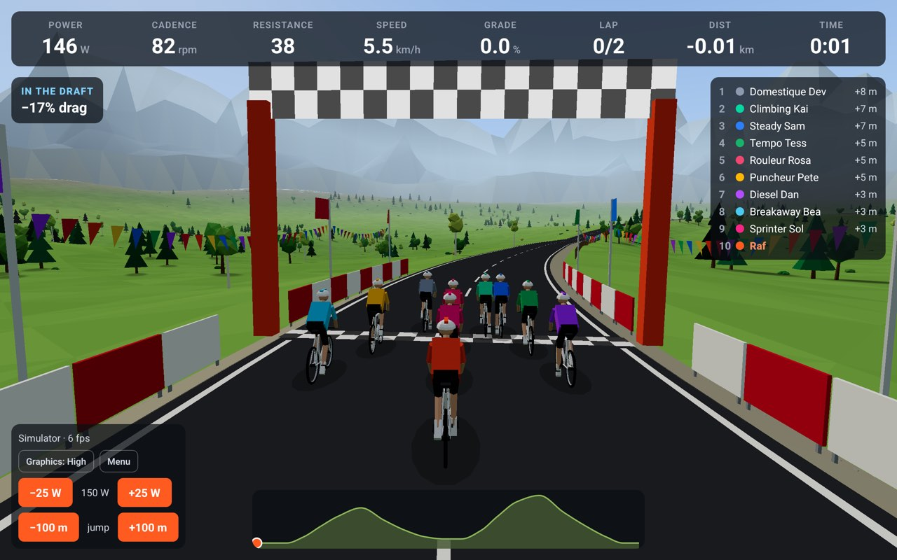

</div>

> [!IMPORTANT]
> **Unofficial project.** Peleton Racer is not made, endorsed or supported by Peloton Interactive, Inc.
> "Peloton" is their trademark and is used here only to say which hardware this runs on. Read the
> [disclaimer](#disclaimer) before installing anything on your bike.

---

## What it is

The Peloton Bike already measures power, cadence and resistance. Peleton Racer reads those numbers on
the bike's own tablet and turns them into a race: a road-cycling physics model converts your watts into
speed on hilly circuits, nine AI rivals try to drop you, and you can chase the best times of everyone
else in your house.

It's an Expo / React Native app with a [React Three Fiber](https://github.com/pmndrs/react-three-fiber)
3D scene, a small Kotlin module that reads the bike's sensors, and a local SQLite database for
profiles and ride history. Nothing goes to the cloud.

## Features

- **Your watts, real physics.** Speed comes from power, gradient, air drag, rolling resistance and _your_
  weight. Climbs hurt, descents are free, and a lighter rider goes uphill faster for the same watts.
- **Drafting and racing lines.** Sit on a wheel to cut drag by up to 30%. Riders steer themselves,
  tucking in behind to draft and pulling out to pass.
- **Three ways to ride.** _Race_ nine bots with different riding styles (Easy, Normal or Hard), _Time trial_ against the clock, or
  _Free ride_ with no finish line. Distances from 1 to 5 laps.
- **Four maps, each with its own course and look.** Alpine Valley, Winter Pass, Autumn Forest and Golden
  Hour Lakes. Each has its own circuit, climbs, weather and light.
- **Household profiles.** A "Who's riding?" screen like a streaming app's. Each person has a colour,
  a weight and their own ride history.
- **Ghost racing.** Every finished ride is recorded. In a time trial you race the ghosts of each household
  member's best time on that course, your own PB included, so you can race each other on different days.
- **A real finish.** Final-lap and 200 m sprint callouts, a checkered gantry, slow motion at the line, a
  finish-line camera, confetti, then results with your power, speed and personal-best margin.
- **Built for the bike's tablet.** Big touch targets, a pause menu on the Android back button, the screen
  kept awake, and a High/Low graphics switch that picks Low by default on the original Bike's older tablet.

## Maps

|                                                                             | Course                                                                                                                | Lap    | Climbing | Max gradient |
| --------------------------------------------------------------------------- | --------------------------------------------------------------------------------------------------------------------- | ------ | -------- | ------------ |
| 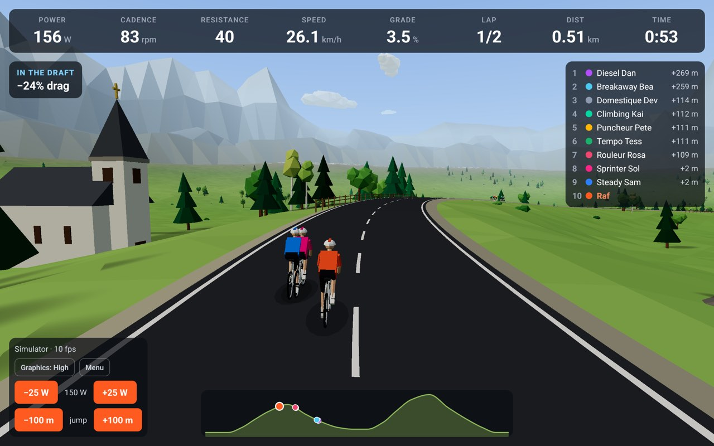     | **Alpine Valley**: a lakeside sprint finish and two punchy climbs towards the peaks, past a hilltop chapel            | 2.1 km | 38 m     | 8.3%         |
| 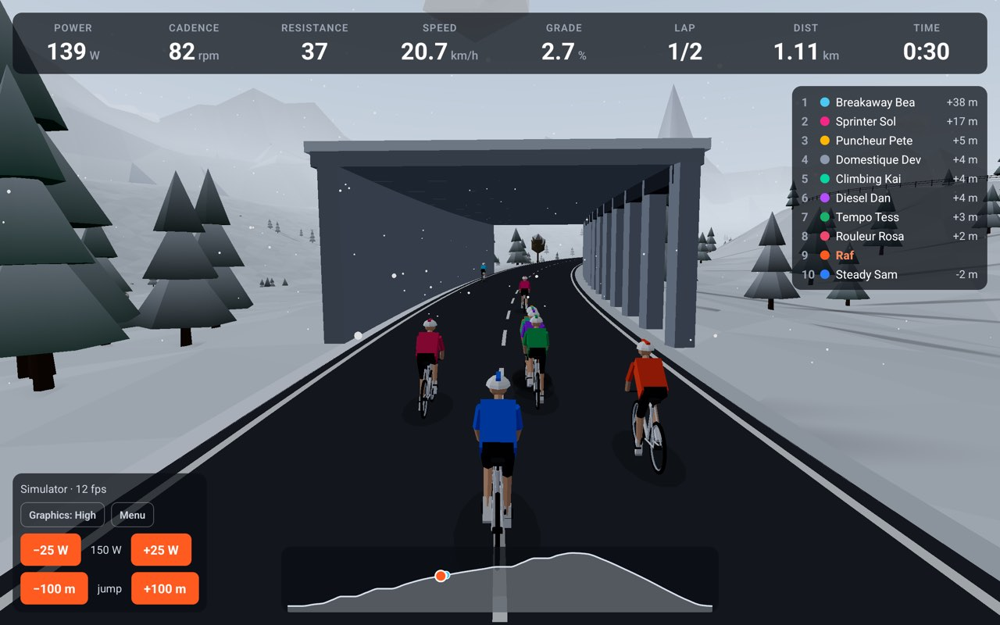       | **Winter Pass**: two pairs of hairpins up the pass in falling snow, through an avalanche gallery, then a long descent | 3.1 km | 61 m     | 7.6%         |
| 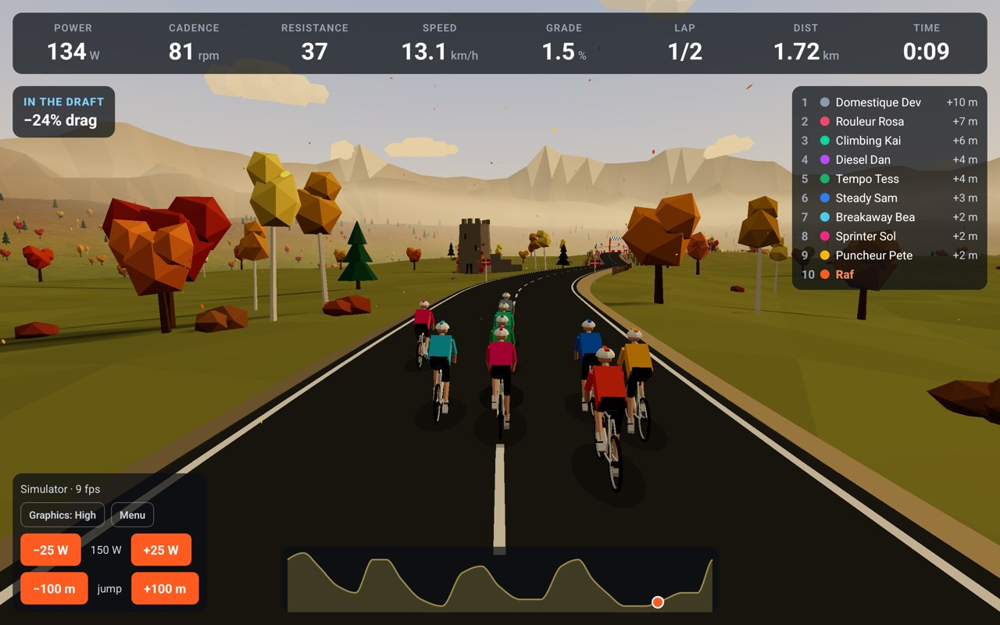   | **Autumn Forest**: twisting lanes and short, steep kickers under a ruined tower, with an uphill finish                | 2.0 km | 25 m     | 10.3%        |
| 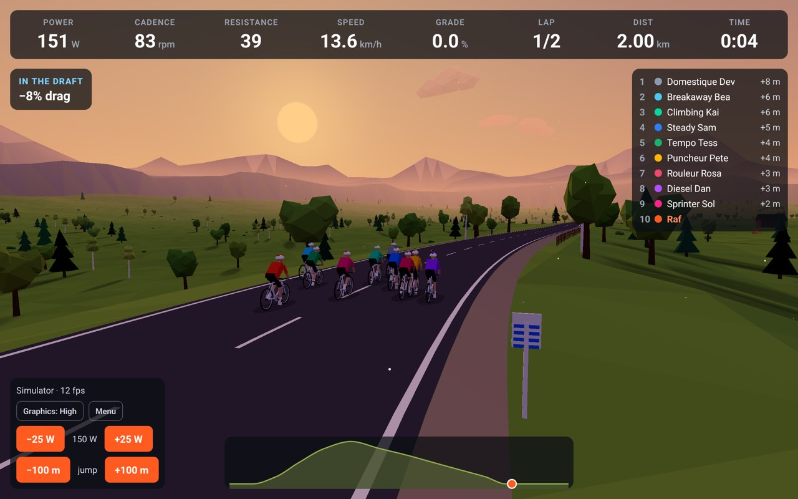 | **Golden Hour Lakes**: fast and nearly flat, sprinting down a lakeside straight past the boathouse                    | 2.4 km | 6 m      | 1.4%         |

## A look around

| Who's riding?                                                                        | Pick a mode, map and distance                                                                 |
| ------------------------------------------------------------------------------------ | --------------------------------------------------------------------------------------------- |
| 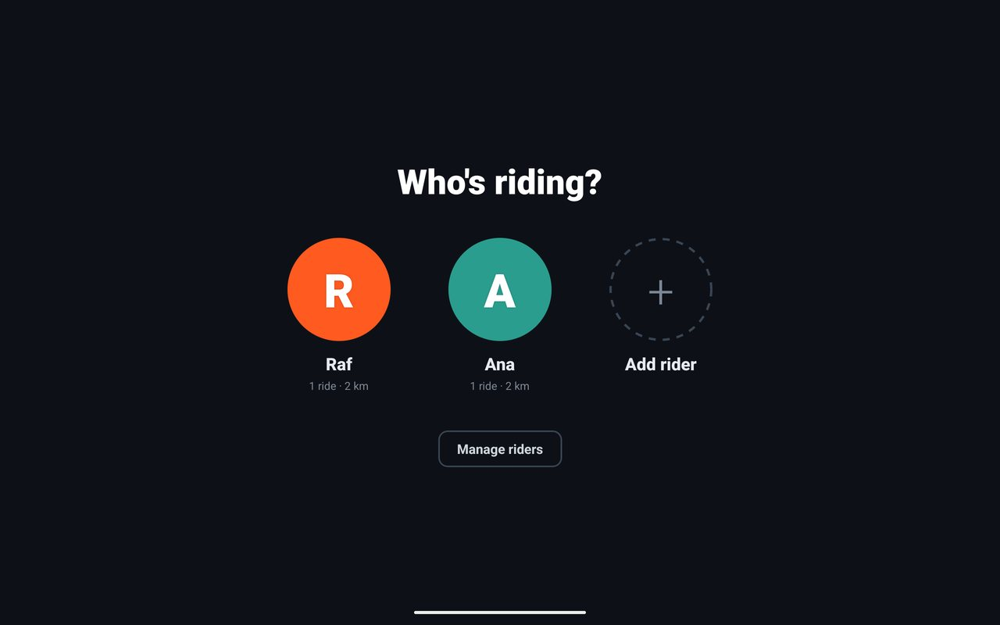            | 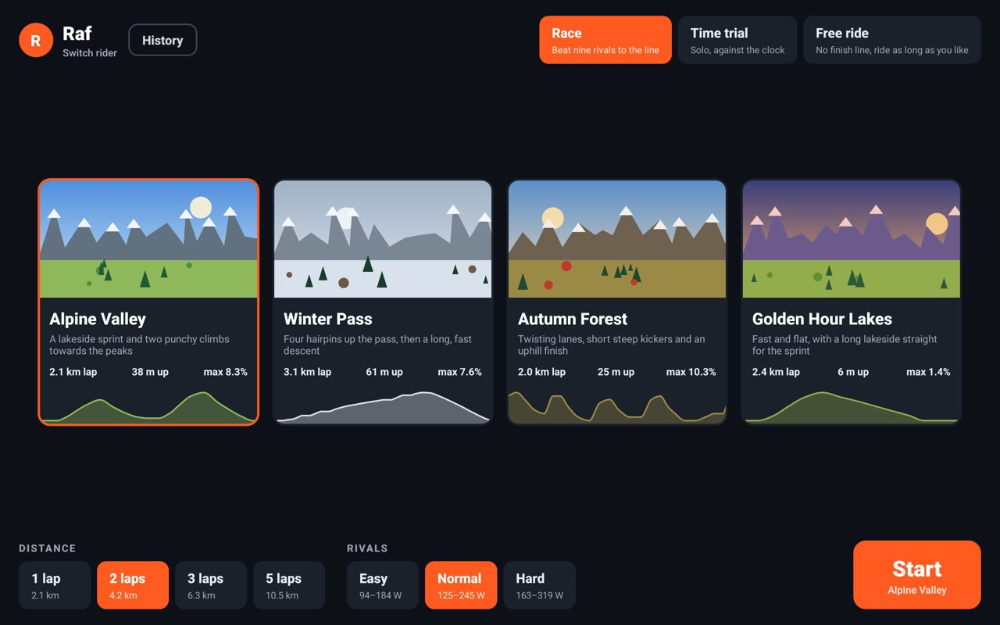         |
| **Racing a household ghost**                                                         | **Results**                                                                                   |
| 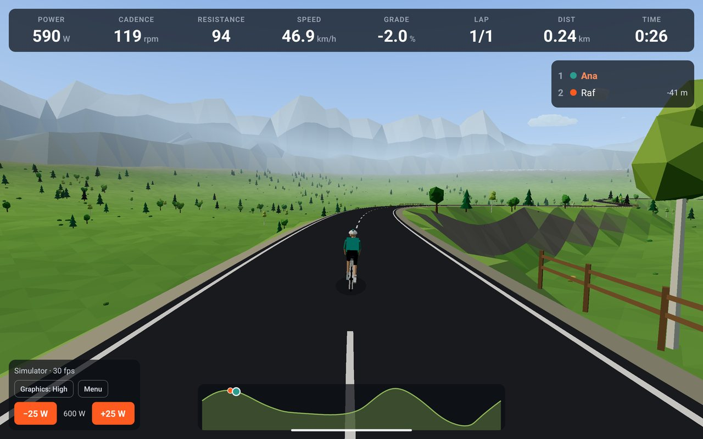 | 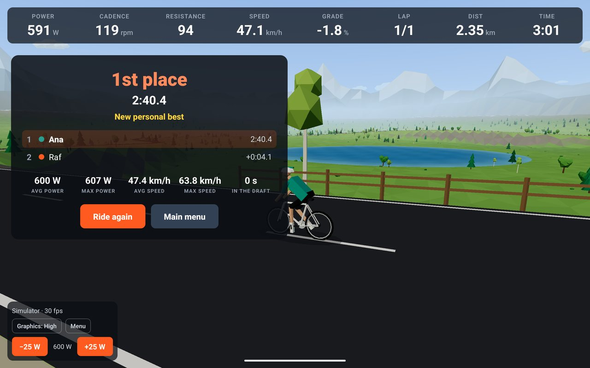 |
| **History and household bests**                                                      | **Pause menu**                                                                                |
| 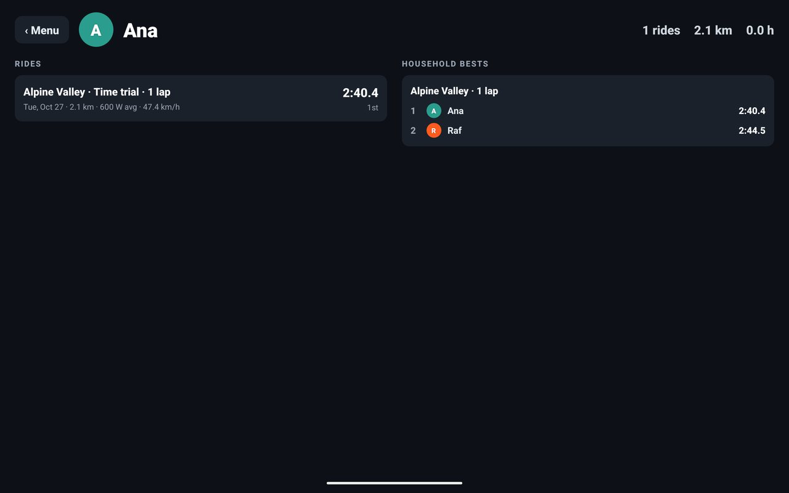               | 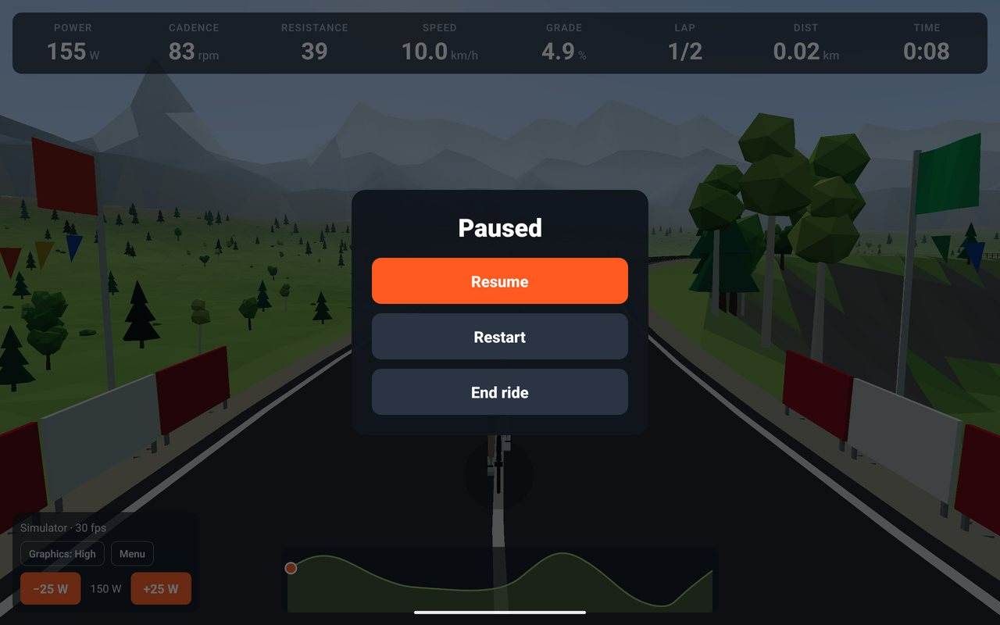          |

## How it works

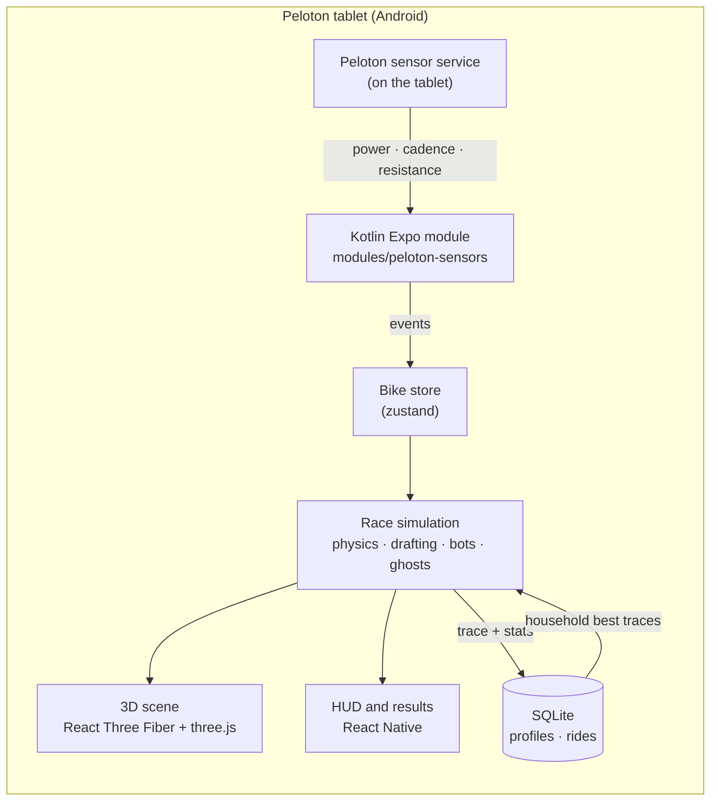

### Reading the bike

The tablet runs a Peloton system service that talks to the bike over a serial link. Peleton Racer binds to
that service directly. This is the same approach the open-source [Grupetto](https://github.com/selalipop/grupetto)
overlay uses, re-implemented here in `modules/peloton-sensors`. It keeps working while the game is
fullscreen, which screen-reading approaches can't.

| Bike                         | Service                          | Protocol                                                                           |
| ---------------------------- | -------------------------------- | ---------------------------------------------------------------------------------- |
| Original Bike (`PLTN-RB1V*`) | `com.peloton.service.SensorData` | Messenger: one repeating request per metric (power in centiwatts, rpm, resistance) |
| Bike+ (`PLTN-TTR01`)         | `com.onepeloton.affernetservice` | Binder `transact(14)` polled every 100 ms, returning a `BikeData` parcel           |

Access is **read-only by design**: the app never writes to the bike or changes its resistance. Hills are
simulated in the physics instead. Off a Peloton (an emulator or a phone), the app falls back to a
**simulator** with ±25 W buttons, so you can develop without a bike.

### Physics

Each frame, every rider's speed follows the usual road-cycling force balance:

```
m·a = P·η / v  −  m·g·sin θ  −  Crr·m·g·cos θ  −  ½·ρ·CdA·(1 − draft)·v²
```

`m` is the profile's weight plus 9 kg of bike, `CdA` = 0.32 m², `Crr` = 0.005 and `η` = 0.97. At 200 W on
the flat that's about 33 km/h, and about 12 km/h up a 6% climb. Drafting takes up to 30% off the drag
term when you're within a few metres of a wheel.

### Ghosts

While you ride, your distance is sampled once a second of race time. A finished ride stores that trace
with its stats. A ghost replays it by interpolating distance at the current race time, so its finish
matches the original to within a few hundredths of a second. Ghosts don't block anyone or give drafts.
They're there to chase, not to collide with.

### Scenery

The world is built from independent layers, each driven by a **theme** (palette, light, terrain shape,
tree mix, weather) and a **quality preset**:

`terrain` · `sky` · `mountains` · `water` · `clouds` · `vegetation` · `road` · `roadside` (markings,
fences, spectators, finish dressing) · `weather` (snow or leaves)

Everything is flat-shaded low-poly with vertex colours and no textures. Trees, spectators and limbs are
instanced, and wind sway, cheering crowds, flags and falling snow are animated in shaders so the CPU
barely touches them each frame. A whole map is about 16 draw calls:

| Quality | Scenery triangles | Default on              |
| ------- | ----------------- | ----------------------- |
| High    | ~200–230k         | Bike+, emulator, phones |
| Low     | ~90–105k          | Original Bike           |

A new look is just a new `Theme` object, and a new map is one entry in `src/game/maps.ts`: a circuit drawn
through control points (`buildCircuit`: x, z and height per point, with a `hairpin` helper), a theme and
its landmarks. The land shapes itself to the road and bends are banked. Run `pnpm maps:report` to check a circuit's
climbs, grades and bends against its tagline, and that the terrain mesh never covers the road.

## Put it on your bike

> [!WARNING]
> **Status:** everything has been tested end to end on an Android emulator using the built-in simulator.
> Binding to the real Peloton sensor service follows Grupetto's protocol but **hasn't been verified on a
> bike yet**. Reports from Bike and Bike+ owners are very welcome.

**You need:**
- A Peloton Bike or Bike+ whose tablet has developer options and ADB enabled. The community
  [OpenPelo](https://github.com/doudar/Openpelo) tool and guides cover this.
- A computer with a current Node LTS, pnpm, JDK 17 and the Android SDK.
- Android 7.0 (API 24) or newer on the tablet.

```bash
git clone https://github.com/raff-codes/peleton-racer.git
cd peleton-racer
pnpm install

pnpm build:apk                    # prebuild + Gradle release build (debug-signed, fine for sideloading)
adb connect <tablet-ip>:5555      # or plug in over USB
pnpm install:bike                 # install or update the APK; your profiles and rides are kept
pnpm logs:sensors                 # should show: status=connected
```

Launch **Peleton Racer** from the tablet's launcher, add a rider, pick a map and start pedalling.

If `logs:sensors` shows `unavailable` or a permission error, please
[open an issue](https://github.com/raff-codes/peleton-racer/issues) with your tablet model
(`adb shell getprop ro.product.model`) and Android version (`adb shell getprop ro.build.version.sdk`).

## Development

```bash
pnpm dev          # build a dev client onto a connected device or emulator
pnpm start        # Metro for the dev client
pnpm typecheck    # strict TypeScript
pnpm lint         # Biome
pnpm maps:report  # each circuit's climbs, grades and bends
```

Without a bike the HUD runs a power simulator: ±25 W buttons, and jump buttons that move the whole field
100 m along the road to look round a course (rides that jump aren't saved).

The race logic and physics are plain TypeScript with no React or three.js, so you can simulate a whole race
headless with `tsx`, which is how drafting, lane changes and ghost replay were tuned.

```
modules/peloton-sensors/   Kotlin Expo module: binds the Peloton sensor service
src/bike/                  connection hook, sensor store, simulator fallback
src/game/                  race simulation, physics, tracks, maps, rider models, the 3D scene
src/game/world/            scenery layers, themes, quality presets
src/data/                  SQLite schema and queries, profiles, ride sessions and ghosts
src/ui/                    menu, profiles, HUD, pause menu, results, history
```

Contributor notes live in [CLAUDE.md](CLAUDE.md), and the roadmap in [TODO.md](TODO.md).

## Credits

- [**qdomyos-zwift (QZ)**](https://github.com/cagnulein/qdomyos-zwift) by Roberto Viola. The research that
  started this project, and the best place to look if you want your bike in Zwift instead.
- [**Grupetto**](https://github.com/selalipop/grupetto). It showed how to read the sensor service from the
  tablet itself. This repo re-implements the protocol rather than copying code.
- [**PeloMon**](https://github.com/ihaque/pelomon). Deep documentation of the original Bike's serial protocol.
- Built with [Expo](https://expo.dev), [three.js](https://threejs.org),
  [React Three Fiber](https://github.com/pmndrs/react-three-fiber), [zustand](https://github.com/pmndrs/zustand)
  and [expo-sqlite](https://docs.expo.dev/versions/latest/sdk/sqlite/).

## Disclaimer

Peleton Racer is an independent hobby project. It is **not affiliated with, endorsed by or supported by
Peloton Interactive, Inc.** "Peloton", "Peloton Bike" and "Bike+" are trademarks of their owner and are used
only to describe compatible hardware.

Enabling developer mode, sideloading apps or modifying your Peloton tablet may break Peloton's terms of
service or affect your warranty or support. You do this **at your own risk**. The software is provided
"as is", without warranty of any kind (see the licence).

Ride within your limits. The game happily encourages sprinting at the line. Your heart and your knees
come first.

## License

Copyright © 2026 Raff Mendes.

Licensed under the [GNU General Public License v3.0](LICENSE): you're free to use, study, change and share
it, and derivative works must stay open source under the same licence.
